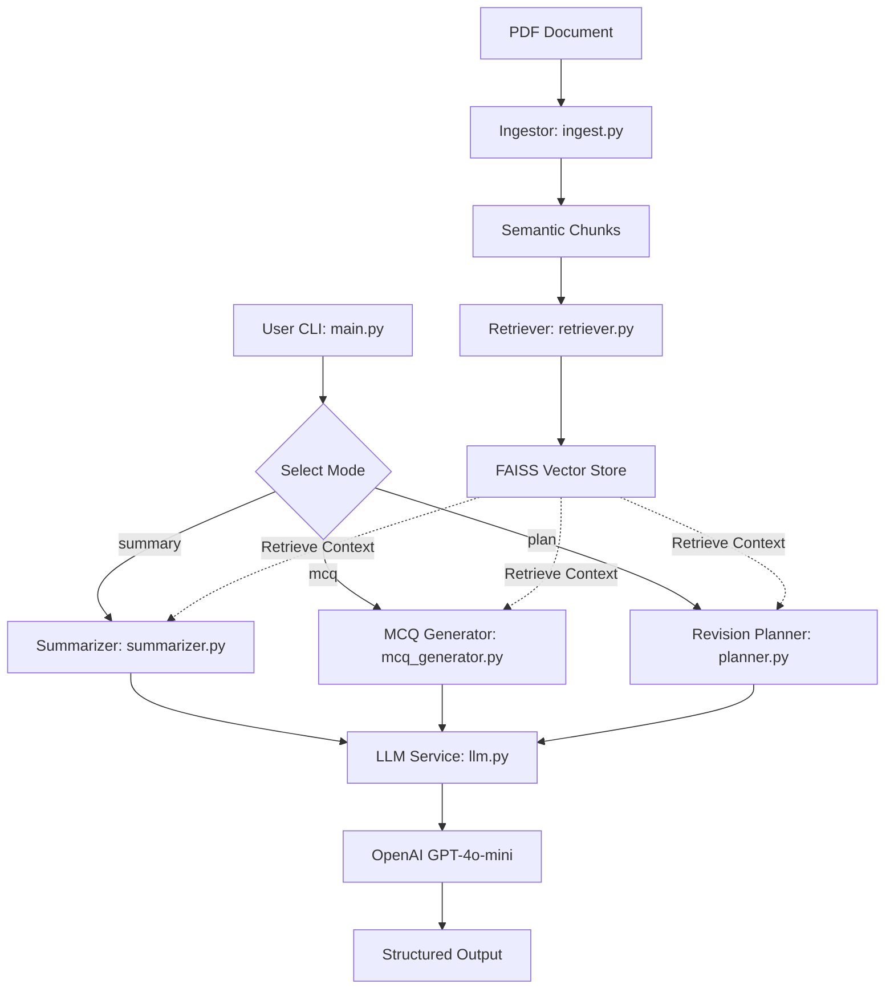

# AI Study Companion RAG System

An intelligent Retrieval-Augmented Generation (RAG) system designed to transform engineering PDFs into actionable study materials, including topic-wise summaries, exam-style MCQs, and structured revision plans.

## Problem
Engineering students often face "information overload" when reviewing dense textbooks and lecture notes. Manually creating summaries and practice questions is time-consuming, and general-purpose AI often "hallucinates" details not present in the specific course material.

## Constraints & Assumptions
- **No Jupyter Notebooks**: Logic is strictly contained in modular `.py` files for production readiness.
- **Code-First Evaluation**: Focus on clean architecture, readable logic, and testability.
- **Privacy & Security**: No secrets committed; API keys managed via environment variables.
- **Data Source**: Assumes high-quality, text-searchable engineering PDFs.
- **Grounding**: All generated content must be strictly grounded in the uploaded documents to ensure technical accuracy.

## System Architecture



## How to Run / Demo

### 1. Installation
```bash
pip install -r requirements.txt
```

### 2. Set Environment Variables
Copy `.env.example` to `.env` or export your OpenAI API key:
```bash
cp .env.example .env
# Edit .env and set your OPENAI_API_KEY
# or:
export OPENAI_API_KEY="your-api-key-here"
```

### 3. Usage & CLI Options

The CLI supports three primary modes: `summary`, `mcq`, and `plan`.

**Topic-wise Summary:**
```bash
python -m src.main --pdf path/to/notes.pdf --mode summary --output summary.md
```

**Exam-style MCQs:**
```bash
python -m src.main --pdf path/to/notes.pdf --mode mcq --num-mcq 10 --output mcqs.json
```

**7-Day Revision Plan:**
```bash
python -m src.main --pdf path/to/notes.pdf --mode plan --output revision_plan.md
```

#### Vector Index Persistence & Caching
To save processing time and API embedding costs on subsequent runs, you can persist and reload FAISS vector indices:

**Build and Save Index:**
```bash
python -m src.main --pdf path/to/notes.pdf --mode summary --save-index ./indexes/my_course
```

**Load from Pre-built Index (no PDF reprocessing needed):**
```bash
python -m src.main --load-index ./indexes/my_course --mode mcq --num-mcq 5
```

### 4. CLI Arguments Reference
| Argument | Type | Default | Description |
|---|---|---|---|
| `--pdf` | `str` | `None` | Path to the engineering PDF file (required if not loading index) |
| `--mode` | `choice` | `required` | Operation mode: `summary`, `mcq`, or `plan` |
| `--num-mcq` | `int` | `5` | Number of MCQs to generate (for `mcq` mode) |
| `--save-index` | `str` | `None` | Directory to save the built FAISS index and metadata |
| `--load-index` | `str` | `None` | Directory to load a pre-built FAISS index from |
| `--output` | `str` | `None` | Path to write output (`.json` for JSON, `.md`/other for Markdown) |
| `--model` | `str` | `gpt-4o-mini` | OpenAI chat completion model |

### 5. Running Tests
```bash
python3 -m pytest
```

## Notes on AI Usage
This project was developed with AI assistance (Jules), following a technical-first approach to architecture and logic. For a detailed breakdown of AI vs. human-guided components, see [AI.md](./AI.md).
