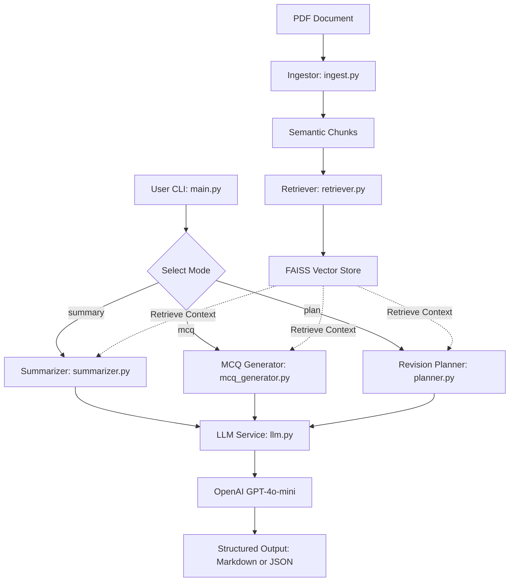

# AI Study Companion RAG System

An intelligent Retrieval-Augmented Generation (RAG) system designed to transform engineering PDFs into actionable study materials, including topic-wise summaries, exam-style MCQs, and structured revision plans.

## Problem
Engineering students often face "information overload" when reviewing dense textbooks and lecture notes. Manually creating summaries and practice questions is time-consuming, and general-purpose AI often "hallucinates" details not present in the specific course material.

## Constraints & Assumptions
- **No Jupyter Notebooks**: Logic is strictly contained in modular `.py` files for production readiness.
- **Code-First Evaluation**: Focus on clean architecture, readable logic, and high testability.
- **Privacy & Security**: No secrets committed; API keys managed via environment variables.
- **Data Source**: Assumes text-searchable engineering PDFs.
- **Grounding**: All generated content is strictly grounded in the uploaded documents to ensure technical accuracy.

## Proposed Solution
A modular RAG pipeline that:
1. **Ingests** PDFs and performs semantic chunking.
2. **Retrieves** relevant context using vector embeddings (FAISS) with batched embedding generation.
3. **Generates** structured study aids (Summaries, MCQs, Plans) using a centralized LLM interface with explicit prompt templates and Pydantic validation.

## System Architecture



## How to Run / Demo

### 1. Installation
```bash
pip install -r requirements.txt
```

### 2. Set Environment Variables
Copy `.env.example` to `.env` or export your OpenAI API key:
```bash
cp .env.example .env
export OPENAI_API_KEY="your-api-key-here"
```

### 3. Usage & CLI Options

Run the CLI via:
```bash
python -m src.main --pdf <path-to-pdf> --mode <summary|mcq|plan> [options]
```

#### CLI Options
| Flag | Type | Default | Description |
|---|---|---|---|
| `--pdf` | string (required) | - | Path to the engineering PDF file |
| `--mode` | string (required) | - | Operation mode: `summary`, `mcq`, or `plan` |
| `--num-mcq` | int | `5` | Number of MCQs to generate (for `mcq` mode, must be >= 1) |
| `--format` | string | `markdown` | Output format: `markdown` or `json` |
| `--output` | string | None | Optional file path to save the output |
| `--model` | string | `gpt-4o-mini` | OpenAI LLM model to use |
| `--timeout`| float | None | API call timeout in seconds |

#### Examples

**Topic-wise Summary (Markdown):**
```bash
python -m src.main --pdf path/to/notes.pdf --mode summary --output summary.md
```

**Exam-style MCQs (JSON output):**
```bash
python -m src.main --pdf path/to/notes.pdf --mode mcq --num-mcq 10 --format json --output mcqs.json
```

**7-Day Revision Plan:**
```bash
python -m src.main --pdf path/to/notes.pdf --mode plan --output plan.md
```

### 4. Running Tests & Static Code Analysis
Run unit test suite:
```bash
python -m pytest
```

Run static analysis & linting:
```bash
ruff check .
```

## Production & Security Features
- **Batched Vector Ingestion**: The retriever batches embedding requests to avoid payload size and rate limit issues.
- **Index Serialization**: Built-in methods to save and load FAISS vector indexes (`save_index` / `load_index`).
- **Resilient Parsing**: Validates PDF file existence, handles empty text pages, and reports encrypted or corrupted files gracefully.
- **Accurate Token Calculation**: Uses `tiktoken` for model-accurate token budgeting in ingestion and utilities.
- **Output Flexibility**: Supports both student-friendly Markdown and machine-readable JSON for integration into learning platforms.

## Notes on AI Usage
This project was developed with AI assistance (Jules), following a technical-first approach to architecture and logic. For a detailed breakdown of AI vs. human-guided components, see [AI.md](./AI.md).
