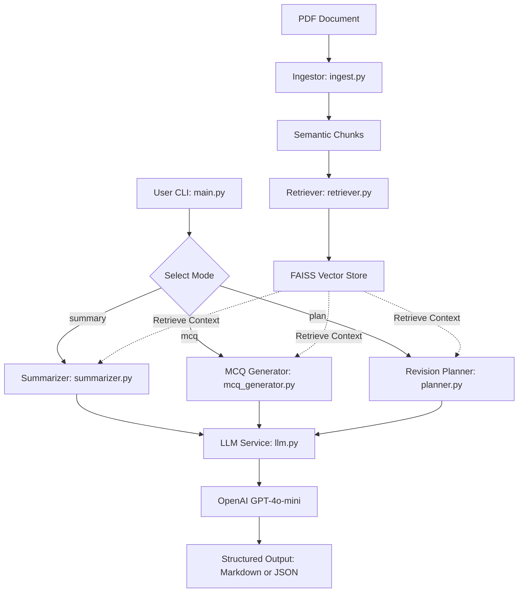

# AI Study Companion RAG System

An intelligent Retrieval-Augmented Generation (RAG) system designed to transform engineering textbooks and lecture notes (PDFs) into actionable, grounded study materials—including topic-wise summaries, exam-style Multiple Choice Questions (MCQs), and structured 7-day revision plans.

---

## Key Features
- **Semantic Chunking**: Extracts PDF content, filters noise, and groups paragraphs up to configurable token limits while respecting page boundaries.
- **Optimized FAISS Vector Retrieval**: Embeds chunks using OpenAI's `text-embedding-3-small` with batched requests and performs similarity search via FAISS.
- **Centralized LLM Service**: Leverages OpenAI structured outputs (`beta.chat.completions.parse`) with strict Pydantic schemas, preventing hallucinated schemas and schema drift.
- **Multiple Output Modes**:
  - `summary`: Topic-wise conceptual breakdown highlighting key definitions, principles, and formulas.
  - `mcq`: Exam-style multiple choice questions with 4 choices, verified correct answer, and detailed explanations.
  - `plan`: 7-day time-boxed revision plan with actionable daily activities.
- **Flexible Export**: Output in either human-readable **Markdown** or structured **JSON**, directly to console (`stdout`) or saved to an output file.

---

## Architecture Overview



### Module Breakdown
- `src/ingest.py`: PDF parsing (`pypdf`), encryption checks, empty page detection, and semantic chunking using `tiktoken`.
- `src/retriever.py`: FAISS index management, batched OpenAI embeddings, and top-$k$ nearest-neighbor retrieval.
- `src/llm.py`: Centralized LLM client handling structured generation, timeouts, error boundaries, and prompts.
- `src/schemas.py`: Pydantic data models with strict field validation constraints.
- `src/summarizer.py`: Topic-wise summary generator.
- `src/mcq_generator.py`: Exam-style MCQ generator.
- `src/planner.py`: 7-day study planner.
- `src/utils.py`: Token counting (`tiktoken`), Markdown formatting, and JSON serialization.
- `src/main.py`: Command-line interface orchestration and output handling.

---

## Setup & Installation

### 1. Requirements
- Python 3.10+ (tested with Python 3.12)
- OpenAI API Key

### 2. Install Dependencies
```bash
pip install -r requirements.txt
```

### 3. Configure Environment Variables
Copy `.env.example` to `.env` and provide your OpenAI API key:
```bash
cp .env.example .env
export OPENAI_API_KEY="your-api-key-here"
```

---

## CLI Usage

### Basic Commands

**Topic-wise Summary:**
```bash
python3 -m src.main --pdf path/to/notes.pdf --mode summary
```

**Exam-style MCQs:**
```bash
python3 -m src.main --pdf path/to/notes.pdf --mode mcq --num-mcq 10
```

**7-Day Revision Plan:**
```bash
python3 -m src.main --pdf path/to/notes.pdf --mode plan
```

### Output Options (Markdown / JSON & File Export)

**Export Summary to Markdown File:**
```bash
python3 -m src.main --pdf notes.pdf --mode summary --output output/summary.md --format markdown
```

**Export MCQs to JSON File:**
```bash
python3 -m src.main --pdf notes.pdf --mode mcq --num-mcq 5 --output output/mcqs.json --format json
```

### Advanced Flags
- `--model <name>`: Specify OpenAI model (default: `gpt-4o-mini`).
- `--timeout <seconds>`: Set request timeout in seconds (default: `60.0`).
- `--format <markdown|json>`: Choose output format (default: `markdown`).
- `--output <path>`: Write generated material to a file instead of only stdout.

---

## Testing & Quality Assurance

### Run Unit and Integration Tests
```bash
python3 -m pytest
```

### Code Formatting & Linting
```bash
ruff check .
```

---

## Notes on AI Usage
This project was developed with AI assistance (Jules), following a technical-first approach to architecture and logic. For details, see [AI.md](./AI.md).
