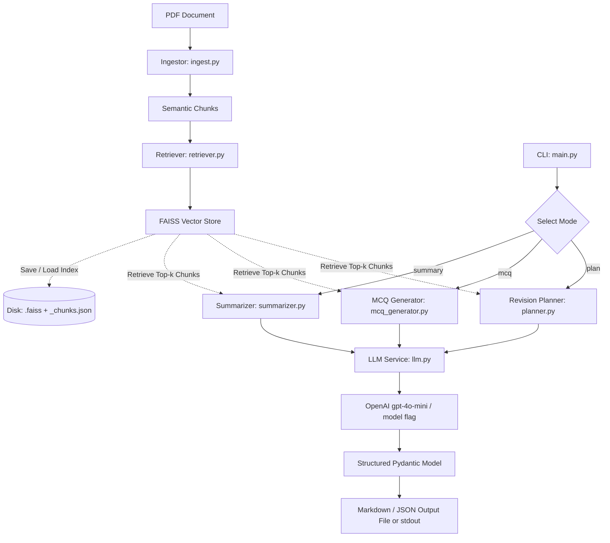

# AI Study Companion RAG System

An intelligent, production-ready Retrieval-Augmented Generation (RAG) system engineered to transform dense technical and engineering PDFs into structured, actionable study materials: topic-wise summaries, exam-style MCQs, and structured 7-day revision plans.

## Problem
Engineering students face cognitive overload when reviewing dense textbooks and lecture notes. Manually extracting formulas, definitions, and practice questions is tedious. Off-the-shelf general AI often hallucinates details missing from course materials.

## Production-Ready Architectural Highlights
- **Strict Grounding & Zero Hallucination**: RAG retrieval passes citations directly to structured prompt templates.
- **Semantic Chunking with Overflow Handling**: Paragraphs are grouped contextually while respecting token ceilings. Overlong sections are cleanly segmented without sentence fragmentation.
- **Vector Index Persistence**: Save and reload FAISS indices (`--save-index` and `--load-index`) to reuse embeddings, minimize latency, and save on OpenAI API costs.
- **Batch Embedding Generation**: Embeddings are batched to stay well within API rate limits and minimize network round trips.
- **Pydantic Type Safety & Export Support**: All outputs conform to strict Pydantic models with validation and direct Markdown/JSON serialization (`--output`, `--format`).
- **Resilient LLM Service**: Automatic exponential backoff retries on transient network/API issues and automatic token budget management.

## System Architecture



## Getting Started

### 1. Installation
Install the project dependencies in your Python 3.12 environment:
```bash
pip install -r requirements.txt
```

### 2. Configure Environment
Copy the example environment configuration and supply your OpenAI API key:
```bash
cp .env.example .env
export OPENAI_API_KEY="sk-..."
```

### 3. Usage & CLI Flags

The system CLI provides comprehensive options:

```text
python -m src.main [-h] [--pdf PDF] --mode {summary,mcq,plan} [--num-mcq NUM_MCQ]
                   [--save-index SAVE_INDEX] [--load-index LOAD_INDEX]
                   [--output OUTPUT] [--format {markdown,json}] [--model MODEL]
```

#### Examples

**Generate Topic-wise Summary and Save Vector Index:**
```bash
python -m src.main --pdf path/to/notes.pdf --mode summary --save-index ./indices/notes_index --output summary.md
```

**Generate Exam-style MCQs from Pre-built Vector Index (Instant Execution):**
```bash
python -m src.main --load-index ./indices/notes_index --mode mcq --num-mcq 10 --format json --output mcqs.json
```

**Generate 7-Day Revision Plan:**
```bash
python -m src.main --pdf path/to/notes.pdf --mode plan --output revision_plan.md
```

### 4. Running Tests
Run the entire automated test suite:
```bash
python -m pytest -v
```

## File Structure
- `src/main.py`: CLI orchestration, argument parser, and high-level execution pipeline.
- `src/ingest.py`: PDF parsing, boundary management, and token-bounded semantic chunking.
- `src/retriever.py`: FAISS vector index, cosine similarity normalization, batched OpenAI embeddings, and disk persistence.
- `src/llm.py`: Centralized LLM interface, token budgeting, prompt construction, and structured output parsing.
- `src/schemas.py`: Pydantic data models with strict validation and Markdown/JSON export methods.
- `src/summarizer.py`: Topic-wise summary generator with page citations.
- `src/mcq_generator.py`: Exam-style multiple-choice questions generator.
- `src/planner.py`: Realistic 7-day revision schedule planner.
- `src/utils.py`: Fast cached tiktoken tokenizer, file helpers, and output writers.
- `tests/`: Full unit and integration test coverage across all modules.

## AI Usage Disclosure
See [AI.md](./AI.md) for details on AI-assisted development and human-guided architecture.
