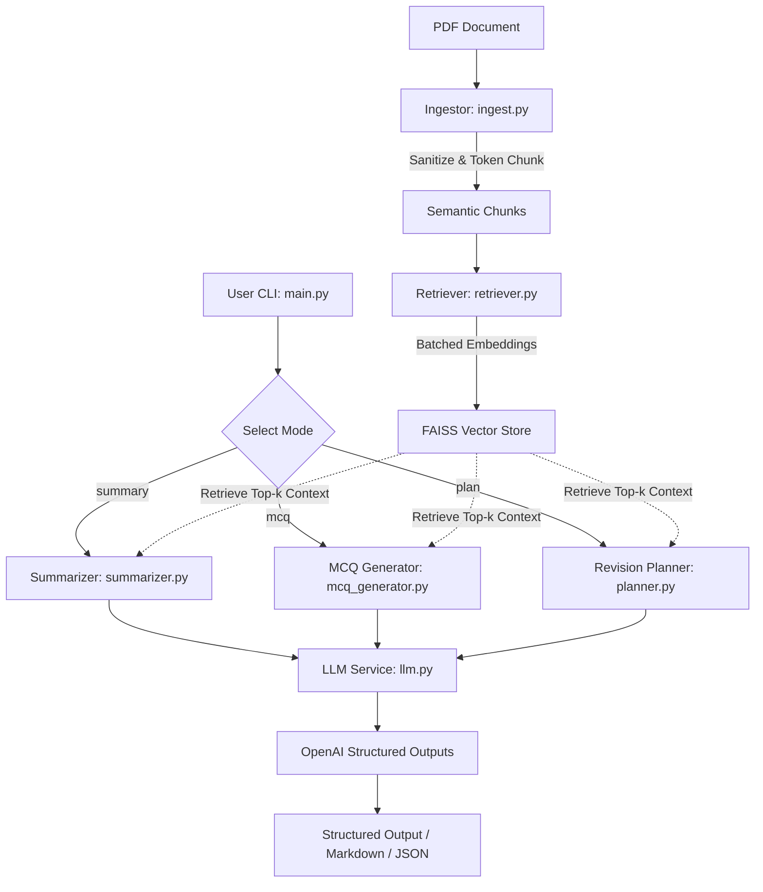

# AI Study Companion RAG System

An intelligent, production-ready Retrieval-Augmented Generation (RAG) system designed to transform dense engineering textbooks and lecture notes into actionable study kits: topic-wise summaries, exam-style MCQs, and structured 7-day revision plans.

---

## Key Features

- **Semantic Chunking & Text Sanitization**: Intelligently groups paragraphs by page boundaries and token thresholds (`cl100k_base`), while splitting oversized passages with sliding window token overlap.
- **Batched Embeddings & FAISS Vector Indexing**: Computes OpenAI embeddings in batches to stay within rate/payload limits, with FAISS index search and full persistence (`--save-index` / `--load-index`).
- **Structured Pydantic Outputs**: Enforces strict typing and validation across all generation modes (Topic Summaries, 4-Option MCQs with verified correct answers, and 7-day Revision Plans).
- **Flexible Export**: Print to CLI or export directly to `.json` or `.md` files via `--output`.
- **Production Error Handling & Logging**: Custom domain exception hierarchy (`DocumentProcessingError`, `VectorIndexError`, `LLMServiceError`) and structured timestamped logging.

---

## System Architecture



---

## Quickstart

### 1. Installation
Install project dependencies in Python 3.10+:
```bash
pip install -r requirements.txt
```

### 2. Environment Configuration
Copy the template and provide your OpenAI API key:
```bash
cp .env.example .env
export OPENAI_API_KEY="your-openai-api-key"
```

Optional environment variables:
- `OPENAI_CHAT_MODEL`: Chat model (default: `gpt-4o-mini`)
- `OPENAI_EMBEDDING_MODEL`: Embedding model (default: `text-embedding-3-small`)
- `LOG_LEVEL`: Logging verbosity (`DEBUG`, `INFO`, `WARNING`, `ERROR`)

---

## Usage Guide

The CLI supports three primary modes: `summary`, `mcq`, and `plan`.

### 1. Topic-Wise Summary
Extracts main concepts and definitions grounded strictly in the source PDF:
```bash
python -m src.main --pdf path/to/notes.pdf --mode summary --output summary.md
```

### 2. Exam-Style MCQs
Generates 4-option multiple-choice questions with answer keys and explanations:
```bash
python -m src.main --pdf path/to/notes.pdf --mode mcq --num-mcq 10 --output mcqs.json
```

### 3. 7-Day Revision Plan
Produces a time-boxed 7-day schedule with allocated study hours and specific tasks:
```bash
python -m src.main --pdf path/to/notes.pdf --mode plan --output plan.md
```

### 4. Vector Index Caching (Faster Subsequent Runs)
Save the generated vector index to disk so large PDFs don't need re-indexing:
```bash
# First run: build and save index
python -m src.main --pdf path/to/notes.pdf --mode summary --save-index ./cached_index

# Later runs: reuse cached index without re-ingesting PDF
python -m src.main --load-index ./cached_index --mode mcq --num-mcq 10
```

---

## Testing

Run the automated test suite using `pytest`:
```bash
python3 -m pytest -v
```

All test cases (ingestion, sub-chunking, retriever batching & persistence, LLM structured mocking, and CLI export) are covered.

---

## Project Structure

```text
├── src/
│   ├── exceptions.py       # Domain exception hierarchy
│   ├── ingest.py           # PDF parsing, text sanitization, token-bounded chunking
│   ├── llm.py              # Centralized OpenAI structured output interface
│   ├── main.py             # CLI application entrypoint and formatters
│   ├── mcq_generator.py    # Exam-style MCQ generation logic
│   ├── planner.py          # 7-day revision plan generator
│   ├── retriever.py        # FAISS index builder, batch embedder, and persistence
│   ├── schemas.py          # Pydantic models and field validators
│   └── utils.py            # Token counting, text cleaning, and logging setup
├── tests/
│   ├── test_cli_utils.py
│   ├── test_ingest.py
│   ├── test_llm.py
│   ├── test_mcq_generator.py
│   ├── test_planner.py
│   ├── test_retriever.py
│   └── test_retriever_advanced.py
├── .env.example
├── pytest.ini
├── requirements.txt
├── README.md
└── AI.md
```
