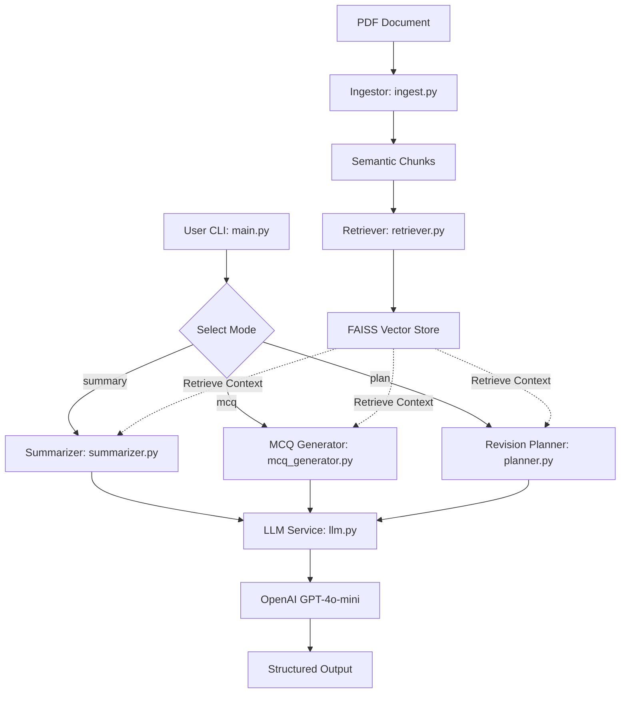

# AI Study Companion RAG System

An intelligent Retrieval-Augmented Generation (RAG) system designed to transform engineering PDFs into actionable study materials, including topic-wise summaries, exam-style MCQs, and structured revision plans.

## Problem
Engineering students often face "information overload" when reviewing dense textbooks and lecture notes. Manually creating summaries and practice questions is time-consuming, and general-purpose AI often "hallucinates" details not present in the specific course material.

## Constraints & Assumptions
- **No Jupyter Notebooks**: Logic is strictly contained in modular `.py` files for production readiness.
- **Code-First Evaluation**: Focus on clean architecture, readable logic, and testability.
- **Privacy & Security**: No secrets committed; API keys managed via environment variables.
- **Data Source**: Assumes high-quality, text-searchable engineering PDFs.
- **Grounding**: All generated content must be strictly grounded in the uploaded documents to ensure technical accuracy.

## Proposed Solution
A modular RAG pipeline that:
1. **Ingests** PDFs and performs semantic chunking.
2. **Retrieves** relevant context using vector embeddings (FAISS).
3. **Generates** structured study aids (Summaries, MCQs, Plans) using a centralized LLM interface with explicit prompt templates.

## System Architecture



## Ideal End State
A production-ready CLI tool where a student can upload their semester notes and receive a comprehensive, grounded study kit in seconds, significantly reducing revision time and improving exam performance.

## Hackathon Scope & Execution
- **Core Focus**: Robust RAG implementation with semantic chunking and structured Pydantic outputs.
- **Modules**:
    - `ingest.py`: PDF parsing and intelligent grouping of paragraphs.
    - `retriever.py`: Vector search using FAISS and OpenAI embeddings.
    - `llm.py`: Centralized chat completion with structured parsing.
- **Testing**: Unit tests for structural integrity of the pipeline.

## How to Run / Demo

### 1. Installation
```bash
pip install -r requirements.txt
```

### 2. Set Environment Variables
Create a `.env` file or export your OpenAI API key:
```bash
export OPENAI_API_KEY="your-api-key-here"
```

### 3. Usage
Run the CLI for different modes:

**Topic-wise Summary:**
```bash
python -m src.main --pdf path/to/notes.pdf --mode summary
```

**Exam-style MCQs:**
```bash
python -m src.main --pdf path/to/notes.pdf --mode mcq --num-mcq 10
```

**7-Day Revision Plan:**
```bash
python -m src.main --pdf path/to/notes.pdf --mode plan
```

### 4. Running Tests
```bash
export PYTHONPATH=$PYTHONPATH:.
pytest
```

## Notes on AI Usage
This project was developed with AI assistance (Jules), following a technical-first approach to architecture and logic. For a detailed breakdown of AI vs. human-guided components, see [AI.md](./AI.md).
