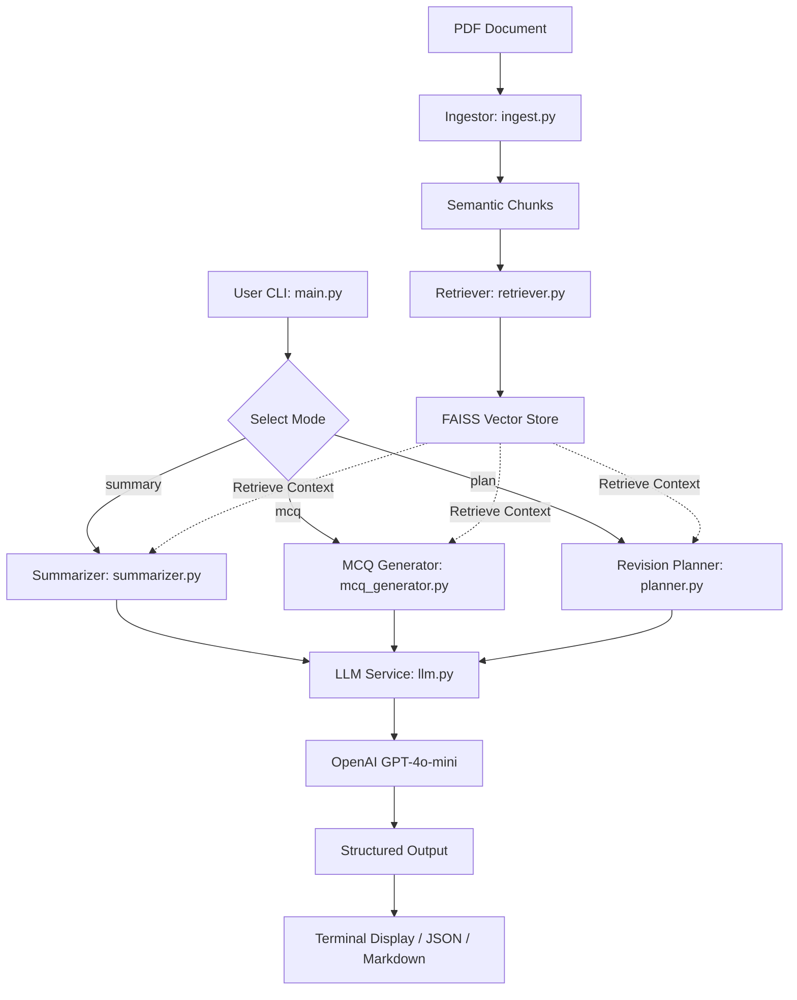

# AI Study Companion RAG System

An intelligent, production-ready Retrieval-Augmented Generation (RAG) system engineered to transform complex engineering PDFs into actionable study materials: topic-wise summaries, exam-style MCQs, and structured 7-day revision plans.

---

## Key Features

- **Semantic Document Ingestion**: Robust PDF extraction with page-boundary tracking, noise filtering, and O(N) token-budgeted semantic chunking.
- **Persistent Vector Store**: High-performance similarity search using FAISS and OpenAI `text-embedding-3-small`, complete with batching and local serialization (`save_index` / `load_index`).
- **Resilient Structured Generation**: Centralized LLM orchestration (`gpt-4o-mini`) using Pydantic structured schemas, retry logic with exponential backoff, and configurable timeouts.
- **Multiple Output Formats**: Direct stdout terminal display, as well as structured JSON and Markdown export options (`--output`).

---

## System Architecture



---

## Installation & Setup

### 1. Prerequisites
- Python 3.12+
- OpenAI API Key

### 2. Install Dependencies
```bash
pip install -r requirements.txt
```

### 3. Configure Environment Variables
Copy `.env.example` to `.env` and set your OpenAI API key:
```bash
cp .env.example .env
```
Or export it directly:
```bash
export OPENAI_API_KEY="your-api-key-here"
```

---

## CLI Usage

Run the CLI via `python3 -m src.main` with desired mode and arguments:

### 1. Topic-Wise Summary
```bash
python3 -m src.main --pdf path/to/notes.pdf --mode summary --output summary.md
```

### 2. Exam-Style Multiple Choice Questions (MCQs)
```bash
python3 -m src.main --pdf path/to/notes.pdf --mode mcq --num-mcq 10 --output mcqs.json
```

### 3. 7-Day Structured Revision Plan
```bash
python3 -m src.main --pdf path/to/notes.pdf --mode plan --output plan.md
```

### 4. Index Persistence (Save & Load)
Save embeddings and index to disk to avoid repeated embedding costs:
```bash
# Ingest and save index
python3 -m src.main --pdf path/to/notes.pdf --mode summary --save-index ./vector_store

# Query against previously saved index (no PDF re-parsing or re-embedding needed)
python3 -m src.main --load-index ./vector_store --mode mcq --num-mcq 5
```

### CLI Options
| Flag | Type | Description |
|---|---|---|
| `--pdf` | `str` | Path to engineering PDF file (required unless `--load-index` is used) |
| `--mode` | `summary\|mcq\|plan` | Generation mode: `summary`, `mcq`, or `plan` |
| `--num-mcq` | `int` | Number of MCQs to generate (default: 5) |
| `--save-index` | `str` | Directory path to persist FAISS index and chunk metadata |
| `--load-index` | `str` | Directory path to load saved FAISS index and chunk metadata |
| `--output` | `str` | File path (`.json` or `.md`) to save generated output |
| `--verbose` | `flag` | Enable detailed debug logs |

---

## Running Tests

Execute the comprehensive test suite with `pytest`:
```bash
python3 -m pytest
```

---

## Project Structure

```
├── src/
│   ├── ingest.py         # PDF parsing, validation, and semantic chunking
│   ├── llm.py            # Centralized LLM client, retries, and structured prompts
│   ├── main.py           # CLI entry point and orchestration
│   ├── mcq_generator.py  # MCQ generation logic
│   ├── planner.py        # 7-day revision schedule generation
│   ├── retriever.py      # FAISS vector store and batched OpenAI embeddings
│   ├── schemas.py        # Pydantic schemas and data validation models
│   ├── summarizer.py     # Topic summarization logic
│   └── utils.py          # Token counting, file validation, and format export
├── tests/                # 30 unit and integration tests across all components
├── .env.example          # Environment variable template
├── AI.md                 # AI usage disclosure
├── requirements.txt      # Dependencies
└── README.md             # Documentation
```
