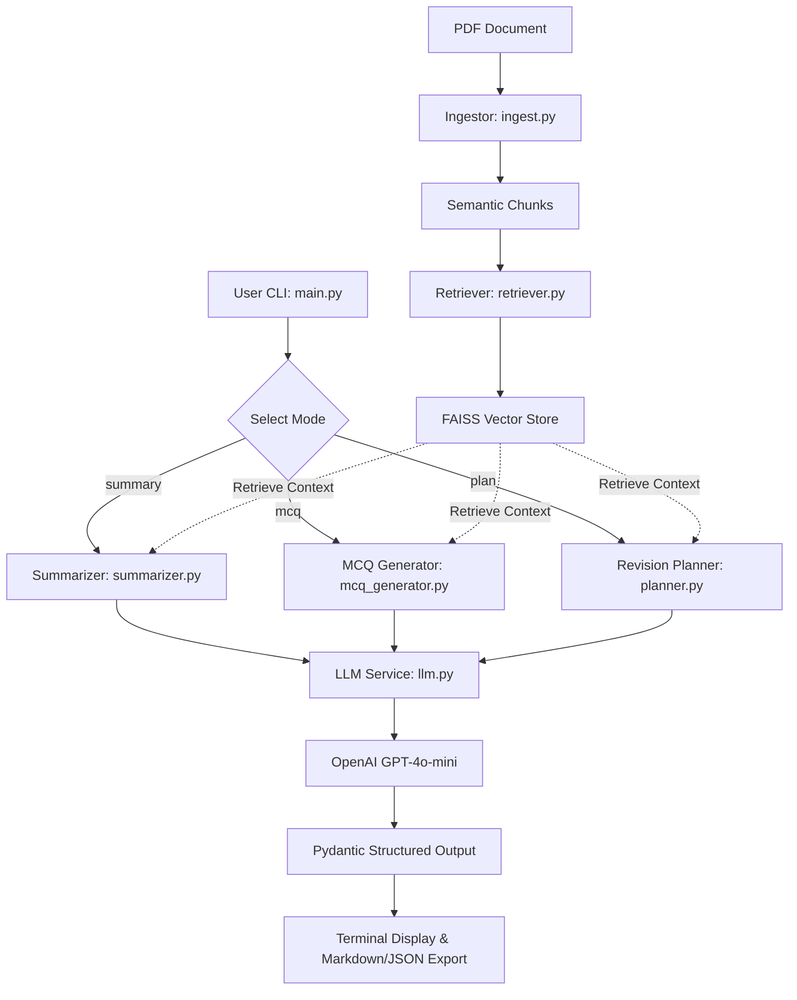

# AI Study Companion RAG System

An intelligent, production-ready Retrieval-Augmented Generation (RAG) system engineered to transform engineering lecture notes and textbooks into actionable study materials: topic-wise summaries, exam-style Multiple Choice Questions (MCQs), and time-boxed 7-day revision plans.

---

## Key Features

- **Semantic Chunking with Token Optimization**: Groups coherent paragraphs while enforcing token limits with an $O(N)$ running token accumulator (preserving performance learnings). Automatically sub-chunks oversized paragraphs.
- **Robust PDF Parsing**: Gracefully handles corrupt, encrypted, or image-only PDFs with explicit error diagnostics (`IngestionError`, `EmptyDocumentError`).
- **Scalable Vector Retrieval**: Uses FAISS vector search with batched OpenAI embedding requests to handle large textbooks without hitting API payload limits.
- **Resilient Structured Generation**: Centralized LLM interface using OpenAI structured outputs (`response_format=PydanticModel`) with exponential backoff retries on rate limits and network drops.
- **Strict Grounding & Answer Validation**: Ensures questions and summaries are grounded in the source text and guarantees MCQ options match the correct answer.
- **Export Capabilities**: Export results directly to Markdown (`.md`) or JSON (`.json`) files for offline study.

---

## System Architecture



---

## Installation & Setup

### 1. Prerequisites
- Python 3.10+ (tested on Python 3.12)
- OpenAI API Key

### 2. Install Dependencies
```bash
pip install -r requirements.txt
```

### 3. Configure Environment Variables
Copy `.env.example` to `.env` and set your OpenAI API key:
```bash
cp .env.example .env
```
Edit `.env`:
```bash
OPENAI_API_KEY="sk-..."
OPENAI_MODEL="gpt-4o-mini" # Optional
OPENAI_EMBEDDING_MODEL="text-embedding-3-small" # Optional
```

---

## CLI Usage

Run the tool via `python3 -m src.main`:

### 1. Topic-Wise Summary
```bash
python3 -m src.main --pdf path/to/notes.pdf --mode summary
```
Save summary to Markdown:
```bash
python3 -m src.main --pdf path/to/notes.pdf --mode summary --output summary.md
```

### 2. Exam-Style MCQs
Generate 10 exam-level MCQs and export to JSON:
```bash
python3 -m src.main --pdf path/to/notes.pdf --mode mcq --num-mcq 10 --output mcqs.json --format json
```

### 3. 7-Day Structured Revision Plan
```bash
python3 -m src.main --pdf path/to/notes.pdf --mode plan --output plan.md
```

### CLI Options Reference
| Flag | Description | Default |
|---|---|---|
| `--pdf` | **(Required)** Path to input PDF file | - |
| `--mode` | **(Required)** Mode: `summary`, `mcq`, or `plan` | - |
| `--num-mcq` | Number of MCQs to generate (1 to 50) | `5` |
| `--output`, `-o` | Output file path (`.md` or `.json`) | `None` (stdout only) |
| `--format` | Output format: `markdown` or `json` | `markdown` |
| `--model` | OpenAI chat model override | `gpt-4o-mini` |
| `--timeout` | Request timeout in seconds | `60.0` |
| `--log-level` | Logging verbosity (`DEBUG`, `INFO`, `WARNING`, `ERROR`) | `INFO` |

---

## Running the Test Suite

Run the full automated test suite (33 tests covering unit, edge cases, retry logic, and CLI end-to-end):
```bash
python3 -m pytest -v
```

---

## Project Structure

```
├── .env.example              # Environment variables template
├── requirements.txt          # Python dependencies
├── README.md                 # Project documentation
├── AI.md                     # AI usage disclosure
├── .jules/
│   └── bolt.md               # Performance learnings and architectural journal
├── src/
│   ├── __init__.py
│   ├── main.py               # Orchestration & CLI interface
│   ├── ingest.py             # PDF text extraction & semantic chunking
│   ├── retriever.py          # FAISS vector indexing & batched embeddings
│   ├── llm.py                # Resilient LLM service with backoff retries
│   ├── summarizer.py         # Topic-wise summary generator
│   ├── mcq_generator.py      # Grounded MCQ generator
│   ├── planner.py            # 7-day revision planner
│   ├── schemas.py            # Pydantic domain models & validators
│   └── utils.py              # Export helpers (Markdown/JSON) & token tools
└── tests/
    ├── test_ingest.py        # PDF extraction & chunking tests
    ├── test_retriever.py     # Vector indexing & batching tests
    ├── test_llm.py           # LLM retry & prompt tests
    ├── test_schemas.py       # Pydantic validation tests
    ├── test_summarizer.py    # Summarization tests
    ├── test_planner.py       # Planner tests
    ├── test_mcq_generator.py # MCQ generator tests
    ├── test_utils.py         # Exporters & token tests
    └── test_main.py          # End-to-end CLI workflow tests
```
