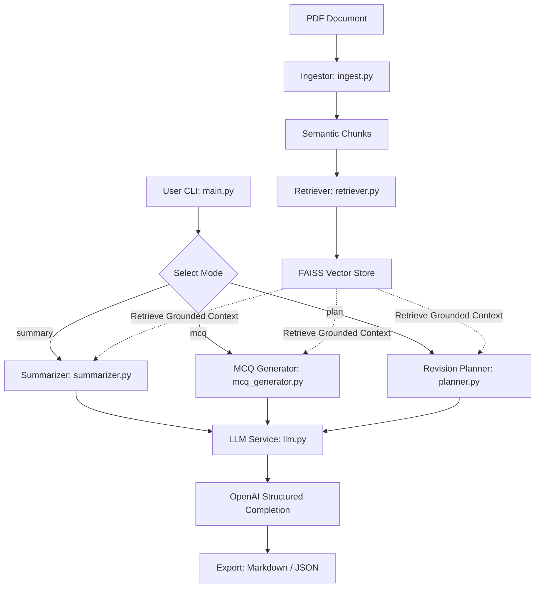

# AI Study Companion RAG System

An intelligent, production-ready Retrieval-Augmented Generation (RAG) system engineered to transform complex engineering PDFs into structured, actionable study materials: topic-wise technical summaries, exam-style practice MCQs, and balanced 7-day revision plans.

---

## Key Features

- **Semantic Chunking**: Context-aware document partitioning that preserves technical continuity without splitting interrelated formulas or theorems across arbitrary boundaries.
- **Token Efficiency (⚡ Bolt)**: Single-pass token counting and chunk buffering to eliminate $O(N^2)$ re-encoding overhead.
- **Fast Dense Vector Search**: High-performance semantic similarity retrieval powered by FAISS and OpenAI's `text-embedding-3-small` with automatic request batching.
- **Strict Pydantic Grounding**: Strict JSON schema enforcement ensuring guaranteed type safety, 4-option validation for MCQs, and structured daily revision scheduling.
- **Multi-Format Export**: Generates both clean GitHub-flavored Markdown and machine-readable JSON, with CLI options for direct file output.

---

## Architecture



---

## Quickstart

### 1. Installation

Ensure you are using Python 3.10+ (tested on Python 3.12):

```bash
pip install -r requirements.txt
```

### 2. Configure Environment

Copy the example environment configuration and supply your OpenAI API key:

```bash
cp .env.example .env
export OPENAI_API_KEY="your-api-key-here"
```

---

## CLI Usage

Run the tool using `python3 -m src.main` with desired mode and flags:

### Topic-Wise Summary
```bash
python3 -m src.main --pdf path/to/notes.pdf --mode summary --format markdown
```

### Exam-Style MCQs
```bash
python3 -m src.main --pdf path/to/notes.pdf --mode mcq --num-mcq 10 --format markdown --output practice_questions.md
```

### 7-Day Revision Plan
```bash
python3 -m src.main --pdf path/to/notes.pdf --mode plan --format json --output revision_schedule.json
```

### CLI Options

| Option | Type | Default | Description |
|---|---|---|---|
| `--pdf` | string | *required* | Path to the source engineering PDF file |
| `--mode` | string | *required* | Operation mode: `summary`, `mcq`, or `plan` |
| `--num-mcq` | int | `5` | Number of practice questions (for `mcq` mode) |
| `--format` | string | `markdown` | Output format: `markdown` or `json` |
| `--output` | string | `None` | Optional path to write output to disk |
| `--model` | string | `gpt-4o-mini` | OpenAI chat completion model name |
| `--timeout` | float | `60.0` | API request timeout in seconds |

---

## Testing & Quality Assurance

Run the test suite via pytest:
```bash
python3 -m pytest
```

Check code quality and linting:
```bash
ruff check .
```

---

## AI Usage Disclosure

See [AI.md](./AI.md) for details on human design versus AI-assisted code generation.
